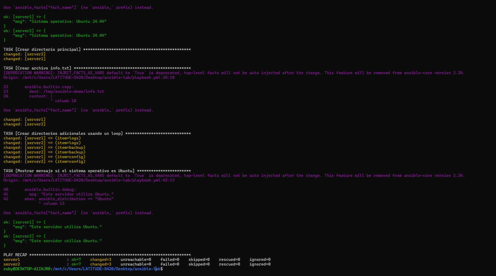

# Práctica 2do Parcial: Ansible

## Objetivo

El objetivo de esta práctica es crear un laboratorio con dos servidores Linux utilizando Docker y administrarlos mediante Ansible. A través de un inventario y un playbook, se ejecutan diferentes tareas para comprobar la conexión y administrar ambos servidores.

## Estructura del proyecto

ansible-lab/
├── docker-compose.yml
├── inventory.ini
├── playbook.yml
├── README.md
└── Evidencia.png

- `docker-compose.yml`: configuración de los dos contenedores Ubuntu.
- `inventory.ini`: inventario de los servidores que administra Ansible.
- `playbook.yml`: tareas que se ejecutan en ambos servidores.
- `README.md`: documentación de la práctica.
- `Evidencia.png`: captura de pantalla de la ejecución exitosa.

## Iniciar los contenedores

Para iniciar los dos servidores Ubuntu, ejecutar:

```bash
docker compose up -d
```

Para comprobar que están funcionando:

```bash
docker ps
```

## Instalar Python en los servidores

```bash
docker exec -it server1 bash
apt update
apt install -y python3
exit

docker exec -it server2 bash
apt update
apt install -y python3
exit
```

## Comprobar la conexión con Ansible

```bash
ansible docker -i inventory.ini -m ping
```

## Ejecutar el playbook

```bash
ansible-playbook -i inventory.ini playbook.yml
```

## Evidencia de ejecución

La siguiente captura muestra la ejecución exitosa del playbook en los dos servidores Ubuntu, incluyendo las tareas realizadas y el resultado final.

